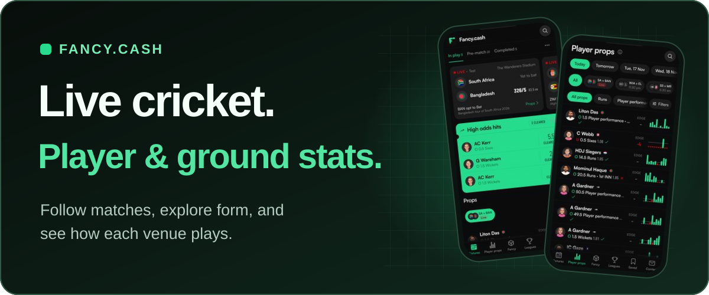
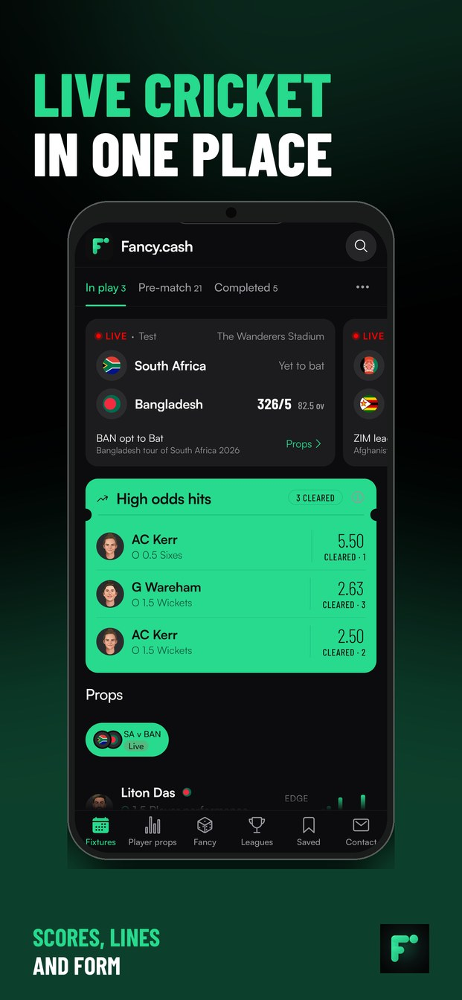
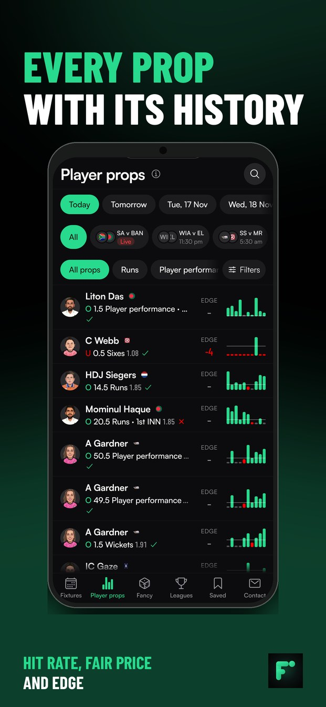
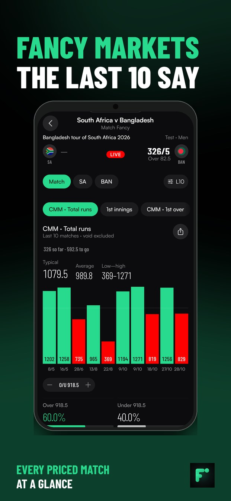
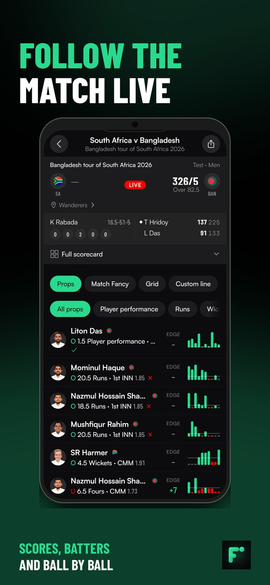
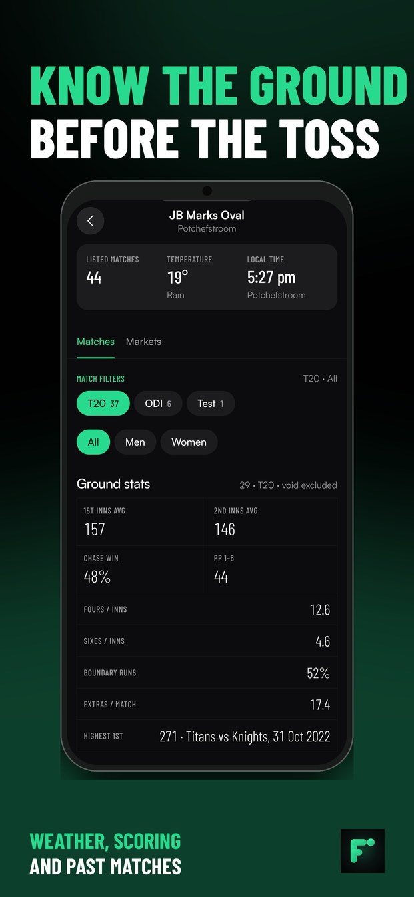
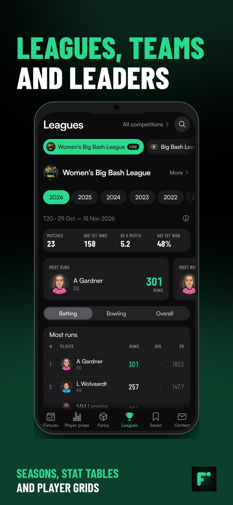

<p align="center"></p>

<p align="center">
  <a href="https://github.com/dheerajgoel17/cricket-data/releases/latest"></a>
</p>

<p align="center">
  <a href="https://fancy.cash"><b>Open Fancy.cash</b></a> ·
  <a href="#screenshots"><b>Screenshots</b></a> ·
  <a href="#features"><b>Features</b></a> ·
  <a href="https://github.com/dheerajgoel17/cricket-data/releases"><b>All releases</b></a>
</p>

## Screenshots

<p align="center">
  
  &nbsp;
  
  &nbsp;
  
</p>
<p align="center">
  
  &nbsp;
  
  &nbsp;
  
</p>

## Features

- **Follow live cricket.** Scores, innings summaries, ball by ball, and what's coming up, with the lines each book offers.
- **Player props, with the history behind them.** Every line shows how often the player cleared it (last 5, 10 or all games), the fair price, and the edge against the books.
- **Fancy markets.** Team and match markets from each side's last matches, with the book's line next to the odds.
- **Get to know a ground.** Weather, scoring patterns and past matches, filtered by format and gender.
- **Leagues and teams.** Seasons, leaders and stat tables, and a grid of every player's last games.
- **Free, no account needed.** Saved lists stay on the phone; sign in only if you want them synced.

## Design

One dark design system for the site and the app: shared tokens (colour, type, spacing, grid, motion), matching components, and guard tests that keep them in step. See the [design system](docs/DESIGN_SYSTEM.md) and the [parity checklist](docs/PARITY_CHECKLIST.md). Tokens also export for Figma (`site/packages/tokens/tokens.dtcg.json`).

## Download

On your Android phone, open the [latest release](https://github.com/dheerajgoel17/cricket-data/releases/latest), tap the `.apk` under **Assets**, and open it to install. Android may ask you to allow installs from your browser.

You can also use [Fancy.cash in your browser](https://fancy.cash). For local iOS and Android builds, see the [mobile app guide](docs/MOBILE.md).

<details>
<summary><b>Cricket dataset and developer documentation</b></summary>

## Cricket dataset

A free cricket dataset. Matches and per-player performance for **23,000+ matches since 2001**:
men's and women's, internationals and leagues. Updated daily, including the latest games.

Match files under `data/` are [CC BY-SA 4.0](DATA_LICENSE.md). The software is source-available ([LICENSE](LICENSE)): read it, run it for yourself, send patches. A competing hosted props or fancy-markets service is not a permitted purpose.

## What's inside

- **Matches**: date, teams, venue, toss, winner, result and margin, player of the match.
- **Players**: runs, balls, fours, sixes, wickets, catches, stumpings, run-outs and performance points for every player in every match.
- CSV files (gzip) in `data/`, one per month. See the [data dictionary](docs/DATA_DICTIONARY.md).

## Quick start

```bash
pip install -e .
cricket-data stats
cricket-data query "Kohli" --since 2026-01-01
cricket-data export-sqlite --out cricket.db
```

More: [Getting started](docs/GETTING_STARTED.md) · [Contributing](CONTRIBUTING.md)

## Support

This project is free. If it's useful to you, you can support it:

<p align="center">
  <a href="https://buymeacoffee.com/meghnaad">
    
  </a>
</p>

Questions: dheerajgoeldsuperdude@gmail.com

## Value bets (optional)
An hourly player-prop value-bet finder runs on top of this dataset: see [docs/VALUE_BETS.md](docs/VALUE_BETS.md).

## Documentation
* [docs/PROJECT_GUIDE.md](docs/PROJECT_GUIDE.md): architecture, data flow, rules, gotchas (start here)
* [docs/OPERATIONS.md](docs/OPERATIONS.md): accounts, secrets, runbooks, health checks
* [AGENTS.md](AGENTS.md): instructions for AI coding agents in any IDE
* Site: [docs/SITE.md](docs/SITE.md), [docs/SITE_MAP.md](docs/SITE_MAP.md) · Data: [docs/DATA_DICTIONARY.md](docs/DATA_DICTIONARY.md), [docs/PROVISIONAL.md](docs/PROVISIONAL.md), [docs/SCRAPER.md](docs/SCRAPER.md) · Value bets: [docs/VALUE_BETS.md](docs/VALUE_BETS.md)

## Stats site
A free player-props site (hit rates over any line, fair decimal odds, partnerships, fancy markets, ask-anything box) lives in [`site/`](site); see [docs/SITE.md](docs/SITE.md).

### Provisional matches and player IDs

`query` and the value-bets pipeline read provisional (scraped) matches together with the monthly
Base CSVs, dropping a provisional match once Base publishes the same fixture (+/-1 day).
Use `cricket-data query NAME --canonical-only` to ignore them. `cricket-data link-players` (also run by
`update`) fills `player_id` in provisional files with Base registry IDs ("Harry Brook" -> "HC Brook");
names it cannot match unambiguously go to `data/provisional_unmatched.csv` and can be fixed in
`data/mappings/player_aliases.csv`. `cricket-data freshness` exits 1 when the newest canonical match is more
than 3 days old; the daily update then opens a `data-stale` issue.

</details>
